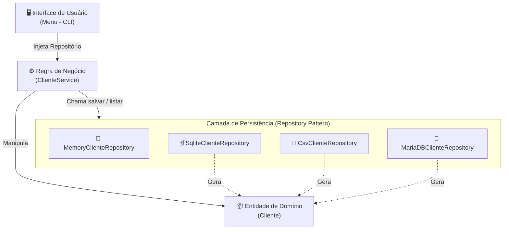

# 🏢 Sistema de Gestão de Clientes — Demonstração do Repository Pattern

Projeto desenvolvido em Python para demonstrar de forma prática o funcionamento, as vantagens e a aplicação do **Repository Pattern** (Padrão Repositório) e da separação de responsabilidades no desenvolvimento de software.

---

## 📌 1. Conceito do Projeto

A aplicação consiste em um sistema de linha de comando (CLI) para cadastro e listagem de clientes. A sua característica central é a **independência da camada de persistência**: o sistema permite salvar e consultar clientes em diferentes mecanismos de armazenamento sem alterar uma única linha da regra de negócio.

O usuário pode escolher e até **alternar dinamicamente em tempo de execução** o local de armazenamento dos dados entre:
- 🧠 **Memória RAM** (`MemoryClienteRepository`)
- 📄 **Arquivo CSV** (`CsvClienteRepository`)
- 🗄️ **Banco de dados local SQLite** (`SqliteClienteRepository`)
- 🐬 **Banco de dados MariaDB / MySQL** (`MariaDBClienteRepository`)

---

## 🏛️ 2. O que é o Repository Pattern?

O **Repository Pattern** é um padrão de projeto arquitetural popularizado por Martin Fowler no livro *Patterns of Enterprise Application Architecture* e amplamente utilizado no *Domain-Driven Design* (DDD).

> *"Um repositório faz a mediação entre o domínio e as camadas de mapeamento de dados, agindo como uma coleção de objetos de domínio em memória."* — Martin Fowler

### 🎯 Problema que resolve
Em projetos convencionais sem uma separação clara, é comum encontrar comandos SQL, conexões de banco de dados ou manipulação direta de arquivos misturados com regras de negócio ou interfaces visuais. Isso gera:
- **Alto acoplamento:** Se você trocar de SQLite para MySQL ou CSV, precisará alterar a regra de negócio.
- **Dificuldade de testes:** Para testar a regra de negócio, você é forçado a ter um banco de dados real configurado e rodando.
- **Violação de princípios SOLID:** A mesma classe calcula regras de negócio e sabe como persistir dados (violando o *Single Responsibility Principle*).

### 💡 Solução
O padrão introduz uma camada intermediária (o repositório) que esconde todos os detalhes técnicos de acesso a dados (SQL, drivers, arquivos, APIs) e expõe métodos orientados à coleção, tais como:
- `salvar(cliente)`
- `listar()`

Para a camada de negócio (`ClienteService`), o repositório se comporta conceitualmente como se fosse uma simples lista na memória.

### 🌟 Principais Benefícios
1. **Desacoplamento:** A lógica de negócio depende de um contrato (métodos `salvar` e `listar`), e não de uma tecnologia de banco de dados específica (*Dependency Inversion Principle*).
2. **Testabilidade:** Torna testes unitários simples e rápidos, pois podemos injetar um repositório em memória (`MemoryClienteRepository`) ou mocks sem precisar de banco de dados ativo.
3. **Flexibilidade e Manutenibilidade:** É trivial adicionar suporte a novos bancos (como PostgreSQL ou MongoDB) criando um novo repositório com os mesmos métodos, sem tocar na classe `ClienteService`.

---

## 🏗️ 3. Como o Padrão foi Implementado neste Projeto

A arquitetura do projeto é dividida em 4 camadas bem definidas:



### 1. Entidade de Domínio (`Cliente`)
Localizada em `src/entities/cliente.py`, representa o objeto central de dados:
```python
class Cliente:
    def __init__(self, name, cpf, email):
        self.name = name
        self.cpf = cpf
        self.email = email
```

### 2. Regra de Negócio (`ClienteService`)
Localizada em `src/service.py`, contém as validações de campos obrigatórios e tamanho de CPF. Ela recebe o repositório via **Injeção de Dependência** no construtor:
```python
class ClienteService:
    def __init__(self, repository):
        self.repository = repository  # Inversão de dependência via Duck Typing

    def cadastrar(self, name: str, cpf: str, email: str):
        self.validar_dados(name, cpf, email)
        cliente = Cliente(name, cpf, email)
        return self.repository.salvar(cliente)
    
    def listar(self):
        clientes = self.repository.listar()
        if not clientes:
            raise ValueError("Nenhum cliente cadastrado.")
        return clientes
```

### 3. Implementações Concretas de Repositório
Cada repositório implementa os métodos `salvar(cliente)` e `listar()`, encapsulando os detalhes de sua tecnologia:

| Repositório | Arquivo | Descrição |
| :--- | :--- | :--- |
| **Memória** | `src/repositories/memory_repository.py` | Mantém os registros em uma lista Python volátil (`self._clientes`). |
| **CSV** | `src/repositories/csv_repository.py` | Lê e grava linhas formatadas em arquivo texto delimitado por vírgula (`dados/clientes.csv`). |
| **SQLite** | `src/repositories/sqlite_repository.py` | Executa comandos SQL em um banco relacional local baseado em arquivo (`dados/database.sqlite`). |
| **MariaDB / MySQL** | `src/repositories/mariadb_repository.py` | Conecta-se via driver PyMySQL a um servidor MariaDB ou MySQL externo. |

### 4. Camada de Apresentação e Injeção (`Menu`)
Localizada em `src/menu.py`, atua como o orquestrador: solicita ao usuário qual mecanismo de persistência deseja usar, instancia o repositório adequado e o injeta na instância de `ClienteService`.

---

## 📂 4. Estrutura de Arquivos e Pastas

```text
projeto/
├── dados/                         # Diretório de arquivos de dados (SQLite, CSV)
│   ├── clientes.csv
│   └── database.sqlite
├── src/
│   ├── database/                  # Gerenciadores de conexões com bancos de dados
│   │   ├── mariadb_connection.py
│   │   └── sqlite_connection.py
│   ├── entities/                  # Entidades de domínio puras
│   │   └── cliente.py
│   ├── repositories/              # Implementações do Repository Pattern
│   │   ├── csv_repository.py
│   │   ├── mariadb_repository.py
│   │   ├── memory_repository.py
│   │   ├── postgres_repository.py
│   │   └── sqlite_repository.py
│   ├── menu.py                    # Interface de usuário via terminal (CLI)
│   └── service.py                 # Camada de serviços e regras de negócio
├── main.py                        # Ponto de entrada da aplicação
├── requirements.txt               # Dependências externas do Python (ex: PyMySQL)
└── README.md                      # Documentação do projeto
```

---

## 🚀 5. Como Executar

### Pré-requisitos
- Python 3.10 ou superior instalado.
- (Opcional) Servidor MariaDB / MySQL ativo se desejar utilizar a opção de MariaDB.

### Passo 1: Criar e ativar o ambiente virtual (venv)
```bash
# Criar o ambiente virtual
python3 -m venv .venv

# Ativar no Linux / macOS:
source .venv/bin/activate

# Ativar no Windows:
# .venv\Scripts\activate
```

### Passo 2: Instalar as dependências
```bash
pip install -r requirements.txt
```

### Passo 3: Executar a aplicação
```bash
python main.py
```

---

## 🎮 6. Exemplo de Utilização

Ao iniciar o programa, selecione o mecanismo de persistência desejado:

```text
=== Selecione o Repositório de Dados ===
[1] Memória
[2] SQLite
[3] MariaDB
[4] Arquivo CSV
Informe o repositório desejado [1-4]: 2

[Iniciado com SQLite]
[1] Cadastrar cliente
[2] Listar clientes
[99] Trocar repositório
[0] Sair
Informe a operação desejada: 1

Cadastro de Cliente
Nome: Maria Silva
CPF: 12345678901
E-mail: maria@exemplo.com

[Repositório SQLite]: Salvando cliente no banco de dados...
Cliente cadastrado com sucesso: {'name': 'Maria Silva', 'cpf': '12345678901', 'email': 'maria@exemplo.com'}
```

Se desejar mudar o repositório para CSV ou Memória a qualquer momento, basta escolher a opção `[99] Trocar repositório`.
